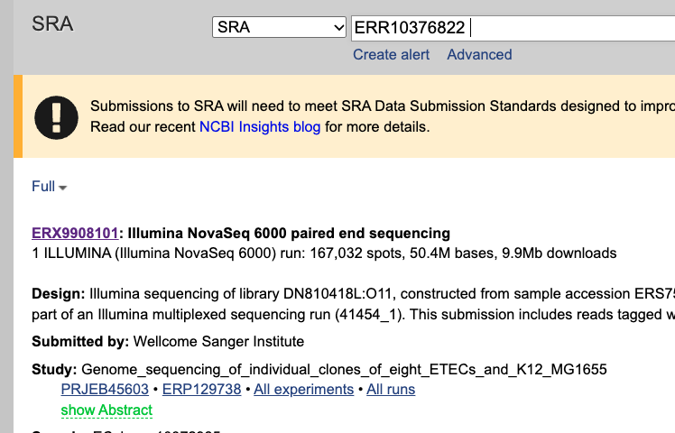
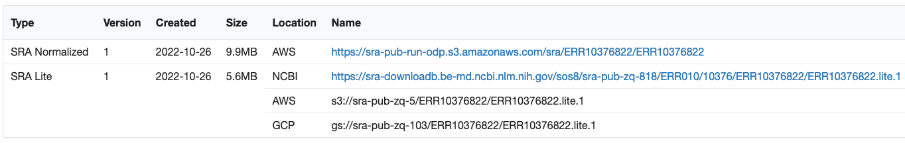

## Part A: Accessing Logan data

### 0. Preparation
We will use some tools. Let's try an install with `pixi`
```bash
# install pixi
curl -fsSL https://pixi.sh/install.sh | sh
source .bashrc 

# create your environment
pixi init my_pixi_logan_env && cd my_pixi_logan_env

# config channels
pixi workspace channel add conda-forge
pixi workspace channel add bioconda

# add need tools
pixi add seqkit sra-tools awscli s5cmd unzip

# start a shell with your environment
pixi shell
```

Test the installation
```bash
aws --version
```

Fix a network issue with aws: 
```bash
aws configure set region us-east-1
```

---

### 1. Exploring an SRA accession

```bash
mkdir ~/logan_tutorial
cd ~/logan_tutorial
```

The Short Read Archive is the central repository of all public sequencing data. Access it at this location: https://www.ncbi.nlm.nih.gov/sra


We will focus here on an E. coli whole-genome sequencing run (Illumina NovaSeq, paired-end, study PRJEB45603), identifier *ERR10376822*, because it is small enough to test.



You may see some more information about the run (ERR10376822) by clicking on it. Head to the `Data access` tab to see how to download that run.



Now, how to download a FASTQ file using the command line? It is not immediate. One way to get a FASTQ file is to first get a SRA file and then convert that SRA file to FASTQ.

There is an easier way, but for now we will go this route, because it will teach us important things about how to get data from the cloud.

To get the SRA file, look at the `SRA archive data` section and download any of the files.

You may download using the first link by typing:

```bash
wget https://sra-pub-run-odp.s3.amazonaws.com/sra/ERR10376822/ERR10376822
mv ERR10376822 ERR10376822.sra
```

Then once you have done the download, what you have is a file in the SRA (or SRAlite) format that needs to be converted to FASTQ. To do that, we use the SRA toolkit:

```bash
fasterq-dump ERR10376822.sra
```

If all went well, you should see files `ERR10376822_1.fastq` and `ERR10376822_2.fastq` in your folder (these are paired-end reads), around 60 MB each.


There is an easier way to get FASTQ files from SRA directly, as alluded above. The `fasterq-dump` program also takes a run identifier as argument:

```bash
fasterq-dump ERR10376822 
```

It will find the location of the SRA file automatically, download it, convert it to FASTQ, and delete the `.sra` file, so that you end up with only the two FASTQ files.

---

Now that you have `fastq` files, you may do any processing you like on those reads, e.g. assemble them or align them. But we won't do that in this tutorial, we will instead show you how to access this same accession using Logan instead.


### 2. Accessing SRA data through Logan

[Logan](https://github.com/IndexThePlanet/Logan/) has assembled all SRA data until late 2023, so this run `ERR10376822` is part of Logan. You may download the Logan assembly using this command:

```bash
aws s3 cp s3://logan-pub/c/ERR10376822/ERR10376822.contigs.fa.zst . --no-sign-request
```

Now you have a FASTA file of the assembly of that run, compressed in Zstandard format.

See if you have the `zstd` and `zstdcat` commands installed on your system by just typing:

```bash
zstdcat
```

Then extract the assembly by typing:

```bash
zstd -d ERR10376822.contigs.fa.zst
```
Now you have download your (first?) Logan assembly!

You may quickly check some basic statistics about the assembly using Seqkit: https://github.com/shenwei356/seqkit/releases

```bash
seqkit stats ERR10376822.contigs.fa -a
```

Should display:

```bash
file                    format  type  num_seqs    sum_len  min_len  avg_len  max_len   Q1     Q2     Q3  sum_gap    N50  N50_num  Q20(%)  Q30(%)  AvgQual  GC(%)  sum_n
ERR10376822.contigs.fa  FASTA   DNA      4,484  5,008,879       31  1,117.1   15,079  233  618.5  1,486        0  2,232      667       0       0        0  50.56      0
```

**Q1 . Repeat the same experiment on unitigs for ERR10376822** 

<details><summary>Answer:</summary>
<p>
Download untigs: 

```bash
aws s3 cp s3://logan-pub/u/ERR10376822/ERR10376822.unitigs.fa.zst . --no-sign-request
```
</p>
</details>

Decompress
```bash
zstd -d ERR10376822.unitigs.fa.zst
```

Quick stats: 
```bash
seqkit stats ERR10376822.unitigs.fa -a
```
    file                    format  type  num_seqs    sum_len  min_len  avg_len  max_len  Q1  Q2   Q3  sum_gap    N50  N50_num  Q20(%)  Q30(%)  AvgQual  GC(%)  sum_n
    ERR10376822.unitigs.fa  FASTA   DNA     13,678  5,395,694       31    394.5   10,344  40  61  354        0  1,513      838       0       0        0  50.79      0


### 3. Quick note about bacterial data

When it comes to bacterial isolates, it is actually not recommended to use Logan. A better resource is AllTheBacteria: https://allthebacteria.readthedocs.io/en/latest/

Because it has bacterial assemblies that are of higher contiguity. To illustrate this, we use here another E. coli run (from a long-term evolution experiment), *SRR2584403*, whose Logan contigs (`s3://logan-pub/c/SRR2584403/SRR2584403.contigs.fa.zst`) have these stats:

    file                    format  type  num_seqs    sum_len  min_len  avg_len  max_len  Q1  Q2     Q3  sum_gap     N50  Q20(%)  Q30(%)  GC(%)
    SRR2584403.contigs.fa   FASTA   DNA      1,297  4,556,063       31  3,512.8   81,999  32  57  1,015        0  22,171       0       0  50.72

Note that AllTheBacteria uses SRA sample identifiers (SAMxxxxxx), not run identifiers (SRRxxxxxx). Not to worry, you can find the sample identifier in the SRA page: https://trace.ncbi.nlm.nih.gov/Traces/?view=run_browser&acc=SRR2584403&display=metadata


Then you can download the AllTheBacteria assembly like this:
```bash
aws s3 cp --no-sign-request s3://allthebacteria-assemblies/SAMN04096045.fa.gz .
```

then 
```bash
gunzip SAMN04096045.fa.gz
```
And notice that it has improved assembly stats compared to contigs:

```bash
seqkit stats -a  SAMN04096045.fa
```
gives:

    file             format  type  num_seqs    sum_len  min_len   avg_len  max_len     Q1      Q2      Q3  sum_gap      N50  Q20(%)  Q30(%)  GC(%)
    SAMN04096045.fa  FASTA   DNA        118  4,544,381      202  38,511.7  348,273  1,034  14,303  46,440        0  110,753       0       0  50.72


Notice how the N50 is greater when compared to the Logan contigs of SRR2584403, though the total lengths are about the same.

### 4. Finding many SRA datasets

Now, downloading a single SRA accession is neat, but what about many many runs? Let us download 100 E.coli assemblies. But how to find the corresponding runs?

One way is to browse the SRA website, search for "ecoli", and painstakingly copy the run names of the 100 first search results. That would take too much time.

A more clever approach is to export a list of [search results](https://www.ncbi.nlm.nih.gov/sra/?term=ecoli):


> Note: on a VM, you may download the list by using: 
    `
    curl -JO https://trace.ncbi.nlm.nih.gov/Traces/sra-db-be/sra-db-be.cgi?rettype=acclist\&WebEnv=MCID_68e910ac0db90717eb13c917\&query_key=2
    `


And then parse that CSV to get just the accession names:
```bash
head SraAccList.csv # to inspect
grep -v "sra" SraAccList.csv | head -n 100 > ecoli.acc.txt
```
Now you have in `ecoli.acc.txt` a list of 100 ecoli accessions. Admittedly, they aren't in a random order, so it may not reflect a broad diversity of E. coli genomes.
This can be mitigated by typing instead:
```bash
grep -v "sra" SraAccList.csv | shuf | head -n 100 > ecoli.acc.txt
```
A more advanced version of this section is available as an independent Logan tutorial: https://github.com/IndexThePlanet/Logan/blob/main/SRA_list.md


<details><summary>Downloading many SRA datasets:</summary>
<p>

### 5. Downloading many SRA datasets

Now you have a truly random sample of E.coli accessions from the SRA. You could download them one by one:
```bash
first_acc=$(head -n 1 ecoli.acc.txt)
echo $first_acc
fasterq-dump $first_acc
```
and repeat for all the other accessions in the file, e.g. with (but do not run that command):
```bash
for acc in $(cat ecoli.acc.txt); do 
    echo $acc; 
    fasterq-dump $acc; 
done
```

But doing this is outside the scope of this tutorial, so we won't do that. 

Instead, to download all the Logan assemblies for this list of accessions, type:
```bash
for acc in $(cat ecoli.acc.txt); do 
    echo $acc; 
    aws s3 cp s3://logan-pub/c/$acc/$acc.contigs.fa.zst . --no-sign-request; 
done
```


You do not need to wait for this command to complete, because, how long do you think it will take? Around a few seconds per accession, and we have 100 accessions, so it will take a dozen minutes or so. I suggest that you interrupt it with Control+C. 

Also, you will notice that some accessions cannot be found. This is because Logan has currently assembled only data prior to 2024, so anything uploaded later is not there.

The point was to show how to download many accessions. 

You may instead of doing a `for` loop, use the `parallel` program (https://ftp.gnu.org/gnu/parallel/). It will download in parallel instead of one after the other. You may add the command line argument `-j 4` to limit it to 4 threads at the same time (by default it uses the number of CPU cores).

Try it, and stop it too with Control+C.


```bash
parallel -j 4 --color  aws s3 cp s3://logan-pub/c/{}/{}.contigs.fa.zst . --no-sign-request ::: `cat ecoli.acc.txt`
```

Or, on IFB VMs:
```bash
parallel -j 4 --color  curl -LJO https://s3.amazonaws.com/logan-pub/c/{}/{}.contigs.fa.zst ::: `cat ecoli.acc.txt`
```


</p>
</details>


Now, let's move on to [Part B](PartB.md).
